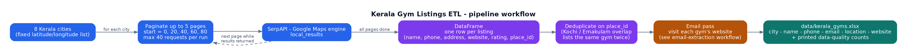
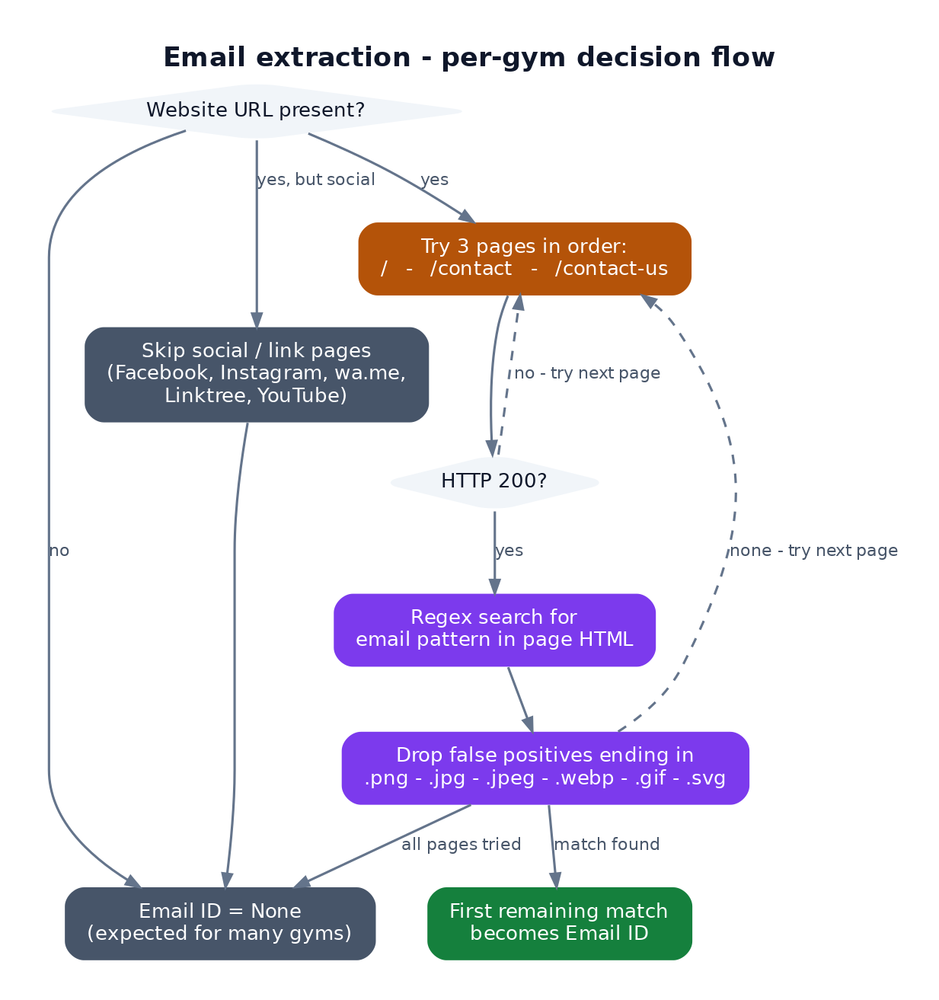

# Step-by-step walkthrough - Kerala Gym Listings ETL

This document explains the pipeline stage by stage: what each part of `gym_pipeline.py` does, why it is built that way, and what to expect when it runs. All code excerpts are the project's actual code, with annotations added for explanation.

## The pipeline at a glance



*Explanatory diagram of the as-built pipeline.*

Four things happen, in order:

1. **Collect** - query Google Maps through SerpAPI for gyms in each of 8 Kerala cities, up to 5 pages each.
2. **Deduplicate** - drop listings that appear in more than one city's results.
3. **Enrich** - visit each gym's website and try to extract a public email address.
4. **Export** - write the cleaned dataset to Excel and print data-quality counts.

## Why the pipeline is shaped this way

The business question is market mapping: who operates gyms across Kerala's major cities, and how can they be reached? Google Maps is the most complete public source of local business listings, but it has three gaps the pipeline is designed around: results come 20 at a time (so pagination is required), the same business appears in overlapping city searches (so deduplication is required), and listings carry no email addresses (so a separate extraction pass is required).

## Step 0 - the API key, and why it comes from the environment

```python
API_KEY = os.environ.get("SERPAPI_KEY")
if not API_KEY:
    raise SystemExit(
        "SERPAPI_KEY environment variable is not set. "
        "Get a key at https://serpapi.com/manage-api-key and set it first."
    )
```

- **What:** the script refuses to start without a key set in the environment.
- **Why:** during the original training session the key was typed directly into the code. For publication it was moved to an environment variable, because a key committed to a public repository is effectively published forever. Failing immediately with a clear message beats a confusing authentication error from the first API call.

## Step 1 - collect, and why pagination works like this

```python
def search(q, ll, start=0):
    r = requests.get(
        "https://serpapi.com/search.json",
        params={
            "engine": "google_maps",
            "type": "search",
            "q": q,
            "ll": ll,        # "@lat,lng,zoom"
            "start": start,  # 0, 20, 40...
            "hl": "en",
            "api_key": API_KEY,
        },
        timeout=60,
    )
    r.raise_for_status()
    return r.json()
```

- **What:** one call to SerpAPI's Google Maps engine per page of results. `ll` pins the search to the city's coordinates; `start` is the offset into the result list.
- **Why coordinates instead of a place name alone:** `ll` anchors the map viewport, so "gyms in Kochi" returns gyms around Kochi's centre rather than whatever a text-only search decides is relevant.
- **Why `raise_for_status()`:** a failed request (bad key, quota exhausted, network error) raises immediately instead of being silently treated as "no gyms in this city".

```python
MAX_PAGES = 5  # 5 pages x 20 results = up to 100 gyms per city

for city, ll in CITIES.items():
    for page in range(MAX_PAGES):
        data = search(f"gyms in {city}", ll, start=page * 20)
        res = data.get("local_results", [])
        if not res:
            break
        # ... collect each listing ...
        time.sleep(1)
```

- **Why 5 pages:** Google Maps returns 20 results per page, so 5 pages capture up to 100 listings per city - enough to cover these cities' gym markets. The cap also bounds cost: 8 cities x 5 pages is a maximum of 40 requests per run (SerpAPI's free plan is 250 searches/month as of November 2026).
- **Why stop on an empty page:** a city with 45 gyms returns results on pages 0-2 and an empty page 3, so the loop moves to the next city instead of burning quota on pages that cannot exist.
- **Why `time.sleep(1)`:** a pause between requests keeps the run polite to the API and away from rate limits.
- **Why keep `place_id`:** it is Google's stable identifier for a business, and it drives the deduplication in the next step.

## Step 2 - deduplicate, and why on `place_id`

```python
# Kochi and Ernakulam overlap heavily, so the same gym appears twice.
df = df.drop_duplicates(subset="place_id").reset_index(drop=True)
```

- **What:** one line removes every repeated listing.
- **Why it is needed:** Kochi and Ernakulam are neighbouring searches whose map areas overlap, so a gym near the boundary appears in both result sets with the same `place_id`. Without this step the dataset would double-count the overlap area.
- **Why `place_id` and not name:** the same gym can appear with small name or address differences between searches, but its `place_id` is identical. Deduplicating on the stable ID catches every duplicate; deduplicating on the name would miss them.

## Step 3 - the email pass, decision by decision



*Explanatory diagram of the `find_email` logic.*

Google Maps listings do not carry email addresses, so the pipeline looks for one on each gym's own website:

```python
EMAIL_RE = re.compile(r"[A-Za-z0-9._%+-]+@[A-Za-z0-9.-]+\.[A-Za-z]{2,}")
SKIP = ("facebook.com", "instagram.com", "wa.me", "linktr.ee", "youtube.com")
BAD_EXT = (".png", ".jpg", ".jpeg", ".webp", ".gif", ".svg")

def find_email(url):
    if not url or any(s in url for s in SKIP):
        return None
    for path in ["", "/contact", "/contact-us"]:
        try:
            r = requests.get(
                url.rstrip("/") + path, timeout=10,
                headers={"User-Agent": "Mozilla/5.0"},
            )
            if r.status_code != 200:
                continue
            found = [e for e in EMAIL_RE.findall(r.text)
                     if not e.lower().endswith(BAD_EXT)]
            if found:
                return found[0]
        except Exception:
            continue
    return None
```

- **Why skip social and link pages:** a Facebook or Linktree "website" is a profile page, not the gym's own site; scraping it finds the platform's addresses, not the gym's. Returning no email is more honest than a wrong one.
- **Why try exactly `/`, `/contact`, `/contact-us`:** business websites overwhelmingly publish contact details on the homepage or a contact page, and those are the two conventional contact paths. Three fetches per gym bounds the time the pass takes across hundreds of gyms.
- **Why a `User-Agent` header:** some sites refuse requests that identify as a script; presenting as a browser avoids pointless 403s.
- **Why `BAD_EXT`:** page HTML often contains strings like `logo@2x.png` that match an email pattern but are image file names. Filtering them out removes the most common false positive.
- **Why return the first match:** the first email-shaped string on a business homepage is almost always the public contact address, and one address per gym is what the dataset needs.
- **Why the broad `except Exception`:** gyms' websites are small-business sites - expired certificates, dead domains and timeouts are normal. Any failure just means "no email from this site", never a crashed run.
- **Why many rows end with no email:** Google Maps does not publish emails, and many gyms have no website or no published address. Empty cells are expected, not a bug.

## Step 4 - export and the printed quality report

```python
final = df[["City", "Gym Name", "Contact No.", "Email ID",
            "Location", "Website URL"]]
out = os.path.join("data", "kerala_gyms.xlsx")
final.to_excel(out, index=False)
```

- **Why these six columns:** they answer the original question - who (name), where (city, location), how to reach (phone, email, website). Working columns used mid-pipeline (`Rating`, `place_id`) are dropped from the export.
- **Why the file is not committed:** the dataset contains real businesses' contact details, so `.gitignore` excludes `data/` and Excel/CSV exports by default. Check before committing anything new.

A run prints its own data-quality summary as it goes. The exact numbers depend on what Google Maps returns on the day, but the shape of the output is:

```
Kochi page 1: 20 results
Kochi page 2: 20 results
...
<rows> rows before cleaning
<rows> unique gyms
<rows> have a website
0/<rows> done
25/<rows> done
...
<rows> emails found
Wrote data/kerala_gyms.xlsx
```

*Expected output shape, reconstructed from the script's print statements - not a captured run.*

An exported row looks like this (illustrative, fictional values):

| City | Gym Name | Contact No. | Email ID | Location | Website URL |
| --- | --- | --- | --- | --- | --- |
| Kochi | Example Fitness Hub | +91 00000 00000 | info@example.com | MG Road, Kochi | https://example.com |

## Run it yourself

```
pip install -r requirements.txt
export SERPAPI_KEY="your-key-here"      # Windows PowerShell: $env:SERPAPI_KEY="your-key-here"
python gym_pipeline.py
```

The email pass visits each website one by one, so allow time for a full run.

## Notes, provenance and test status

- Reconstructed from the training conversation in which this project was built. The only publication change: the API key moved from inline code to the `SERPAPI_KEY` environment variable, and notebook-only helpers became print statements.
- The published code has been syntax-checked but not run end-to-end since reconstruction.
- SerpAPI's terms and the target websites' terms apply to any use of this code. The scraped contact dataset is private and is not part of this repository.
